<div align="center">

# Previsora Wallet

**Smart treasury management for stablecoins.** One place for your on-chain wallets and exchange accounts, with percentage-based savings envelopes on top.


</div>

Previsora Wallet aggregates USDC, USDT and USD1 balances from Ethereum wallets and Binance, then lets users split that liquidity into named, icon-tagged **envelopes** (emergency fund, travel, car…). Each envelope receives a percentage of **each funding source** (a connection + an asset), and the app shows how much is allocated versus still free, in real time.

It is a full-stack project: a dark-only React Native app, a Supabase backend (Postgres + Row Level Security + Deno Edge Functions) and integrations with Alchemy and the Binance API. Wallet and exchange connections are currently on **testnets** (Sepolia and Binance Spot Testnet), so no real funds are involved.

## Demo

<p align="center">
  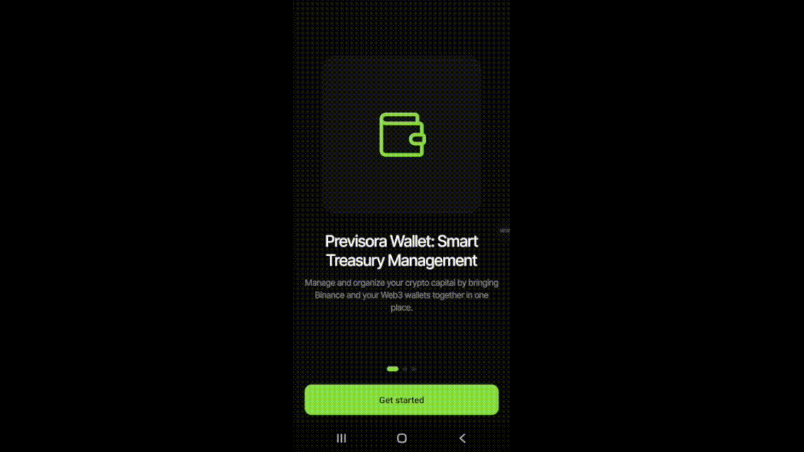
</p>

<p align="center"><a href="screenshots/Demo.mp4">Watch the full-quality video (MP4)</a></p>

### Screenshots

Dark UI built on a `#0C0C0C` base, a single lime accent (`#8BDF42`) and Inter Tight with tabular numerals for balances.

| Onboarding | Sign in | Create account |
|:---:|:---:|:---:|
| 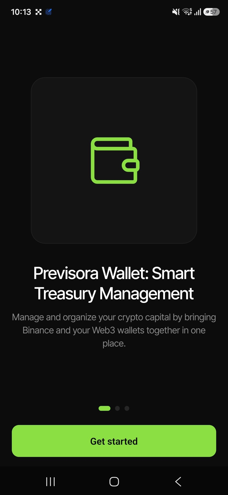 | 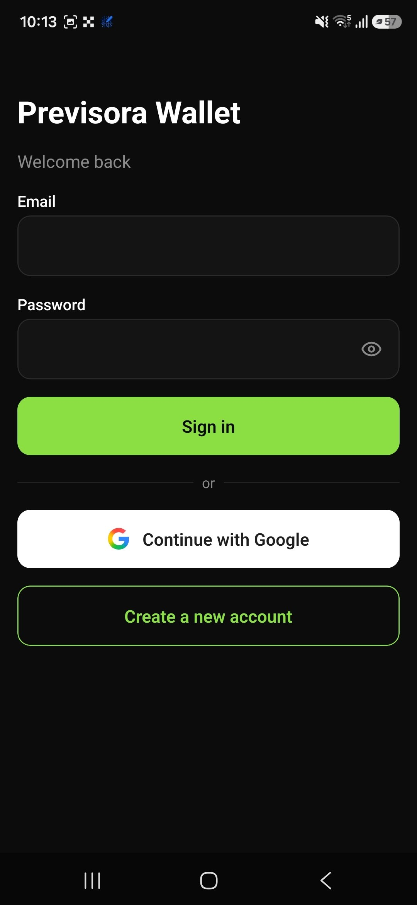 | 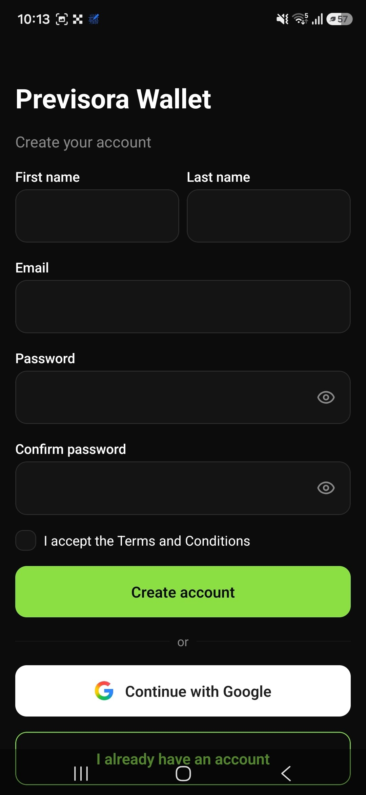 |

| Balances | Envelopes | Manage allocation |
|:---:|:---:|:---:|
| 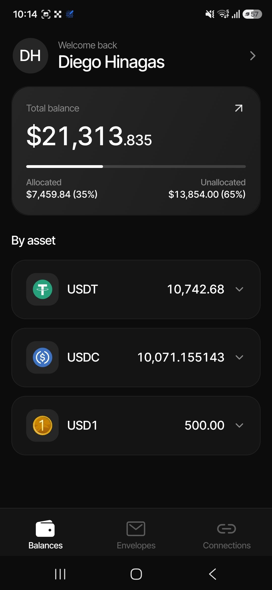 | 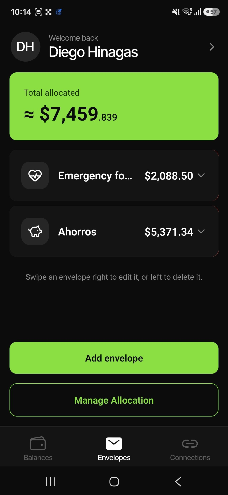 | 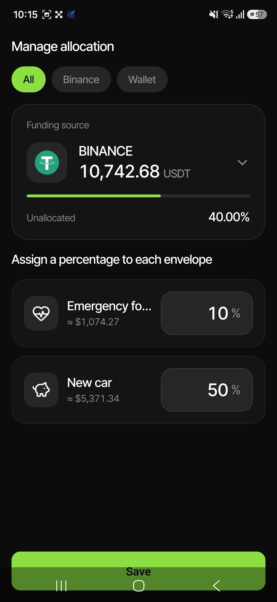 |

| Connections | Add connection | Profile |
|:---:|:---:|:---:|
| 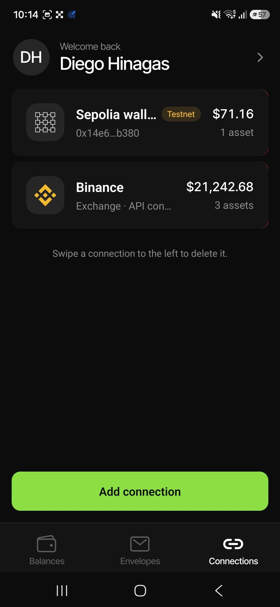 | 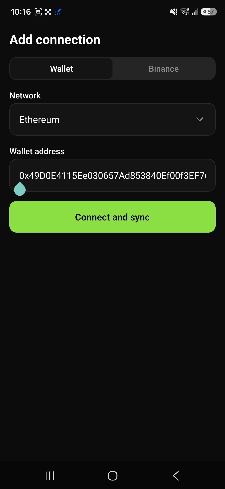 | 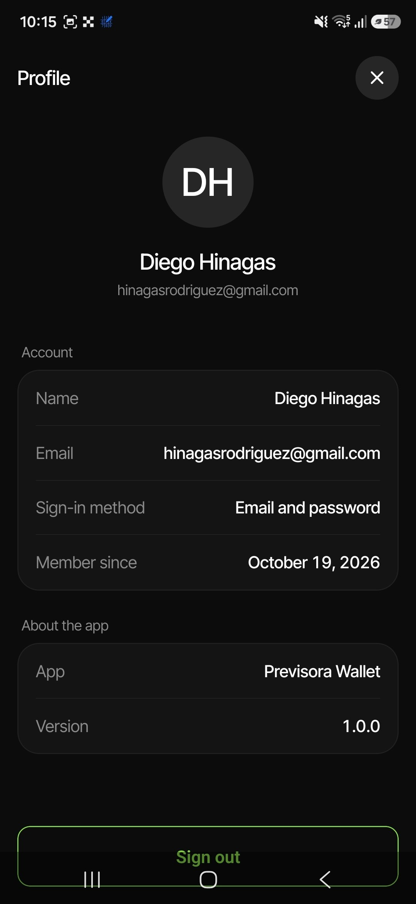 |

## Features

- **Unified balances:** connect Ethereum or Sepolia wallets and Binance; see a total, a per-asset view and a per-connection breakdown.
- **Envelopes:** create, rename, re-icon (20 icons) and delete envelopes with swipe gestures.
- **Allocation by funding source:** each source (for example *Binance · USDT*) has its own 100% to distribute across envelopes, with a live dollar preview per envelope.
- **Allocated vs unallocated:** the home card shows how much of the total is committed to envelopes.
- **Near real-time wallets:** Alchemy Notify webhooks push address activity to the backend, which refreshes balances without the user doing anything.
- **Accounts:** email sign-up with confirmation (the app signs the user in automatically once the link is opened, even from another device) and Google sign-in.

## System Architecture Overview

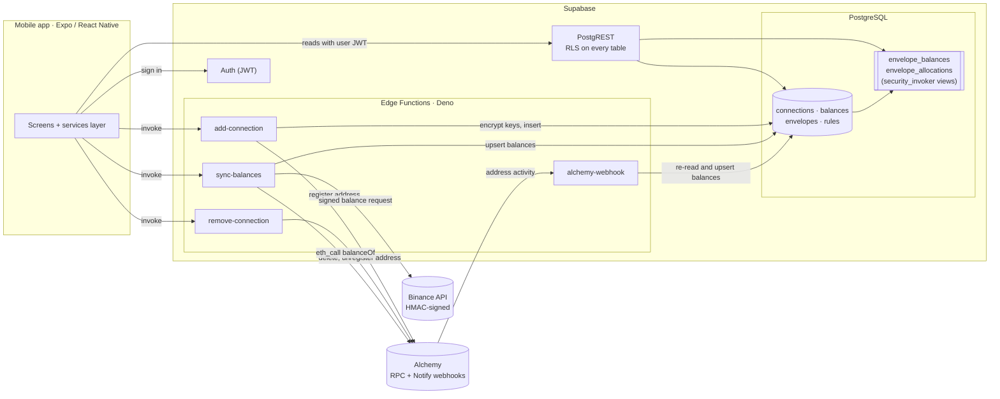

### Edge Functions

| Function | Responsibility |
|---|---|
| `add-connection` | Validates the caller and the payload, normalizes provider and network, **encrypts exchange credentials**, inserts the connection and registers wallet addresses on the Alchemy webhook (fail-safe: an Alchemy error is logged and never fails the request). |
| `remove-connection` | Verifies ownership through RLS, deletes with the service role (users have no `DELETE` policy on `connections`) and removes the address from the webhook **only if no other connection still uses it**. |
| `sync-balances` | For each active connection: reads Binance through a signed request, or reads ERC-20 balances over Alchemy RPC; then upserts into `balances` with the service role. One failing connection never blocks the others. |
| `alchemy-webhook` | Receives Address Activity events, resolves the affected connections in a single query, re-reads their balances and upserts them. |

### How the data flows

1. **Connect.** The app calls `add-connection`. Credentials are encrypted before they touch the database, and a wallet address is registered on the Alchemy webhook for its network.
2. **Sync.** `sync-balances` pulls balances from Binance (HMAC-SHA256 via Web Crypto) and from the chain (`eth_call` to the token's `balanceOf`), restricted to the active assets in `supported_assets`.
3. **Stay current.** When a wallet moves funds, Alchemy calls `alchemy-webhook`, which refreshes only the affected connections.
4. **Allocate.** Users assign percentages per funding source. Rules are stored per `(envelope, connection, asset, trigger)` with a unique constraint, so saving is a single idempotent upsert.
5. **Compute in the database.** Envelope balances are never stored; they are derived by views, so every client gets the same numbers:

```sql
CREATE VIEW public.envelope_balances
WITH (security_invoker = on) AS
SELECT e.id AS envelope_id, e.name, e.icon,
       COALESCE(SUM(b.amount * r.percentage_to_route / 100), 0) AS allocated_amount,
       e.created_at
FROM public.envelopes e
LEFT JOIN public.rules r    ON r.target_envelope_id = e.id AND r.is_active
LEFT JOIN public.balances b ON b.connection_id = r.source_connection_id
                           AND b.asset = r.source_asset AND NOT b.delete_status
WHERE NOT e.delete_status
GROUP BY e.id, e.name, e.icon, e.created_at;
```

`security_invoker = on` makes the view run with the **caller's** permissions, so Row Level Security still applies through it. A second view, `envelope_allocations`, returns the per-source breakdown shown when an envelope is expanded.

### Data model

`profiles` · `supported_assets` · `connections` · `balances` · `envelopes` · `rules` · `execution_logs` · `user_tracked_assets`. The whole schema, triggers and views live in [`scripts/database`](scripts/database) and are applied through the Supabase SQL Editor.

## Security & Compliance

- **Encryption of exchange credentials.** API keys and secrets are encrypted in the Edge Function with **AES-256-GCM** (Web Crypto) before they are stored. The key is derived with SHA-256 from the `ENCRYPTION_KEY` secret, every value gets a fresh random 12-byte IV, and the authentication tag is stored alongside the ciphertext (`iv:tag:ciphertext`), so tampering is detected on decryption. Credentials are decrypted only inside `sync-balances`, only to read balances.
- **Row Level Security everywhere.** RLS is enabled on every table.
  - `connections`: users can read and insert their own rows; there is **no** `UPDATE` or `DELETE` policy, so changes go through functions that also keep the Alchemy webhook consistent.
  - `balances`: read-only for users; writes happen only with the service role inside Edge Functions.
  - `supported_assets`: read-only catalog for authenticated users.
  - `envelopes` and `rules`: scoped to `auth.uid() = user_id`.
- **Server-side authorization.** Each Edge Function validates the caller with `auth.getUser()` on the forwarded JWT, and ownership is checked through RLS before any privileged action. The service-role key never leaves the backend.
- **Least privilege for exchanges.** The app tells users to create **read-only** Binance keys (reading enabled; trading, withdrawals and transfers off) and never asks for more.
- **Views respect RLS.** `security_invoker` views mean derived data cannot leak across users.
- **No account enumeration.** Failed sign-ins show one generic message, and sign-up behaves the same for new and existing emails.
- **Public client, private secrets.** The app ships only the Supabase URL and publishable key. Secrets (`ENCRYPTION_KEY`, Alchemy tokens, service role) live in Supabase secrets.

> This is a portfolio project: it has not been through a formal security audit and does not claim any regulatory certification. Binance runs against the Spot **testnet**.

## Tech Stack

| Layer | Technology |
|---|---|
| Mobile | React Native 0.88, Expo SDK 58, Expo Router, TypeScript (strict) |
| UI | Custom dark design system (tokens in `src/theme`), Inter Tight, Lucide icons, `expo-image`, gesture-handler / Reanimated for swipe actions |
| Backend | Supabase: Auth, PostgreSQL with RLS, PostgREST, Edge Functions on **Deno** |
| Database | PostgreSQL views (`security_invoker`), triggers, SQL-managed schema |
| Integrations | Alchemy (RPC and Notify webhooks), Binance API (HMAC-SHA256), Google OAuth |
| Tooling | Node.js and bun (Expo/Metro toolchain), EAS Build for Android APKs |

## Project Structure

```
mobile/
  src/app/         Expo Router routes (auth, tabs, modals)
  src/components/  UI primitives and screens' building blocks
  src/services/    The only layer that talks to Supabase
  src/theme/       Design tokens (colors, typography, spacing, radius)
supabase/
  functions/       add-connection · remove-connection · sync-balances · alchemy-webhook · shared
scripts/database/  Schema, triggers and views (SQL)
screenshots/       Images used in this README
```
